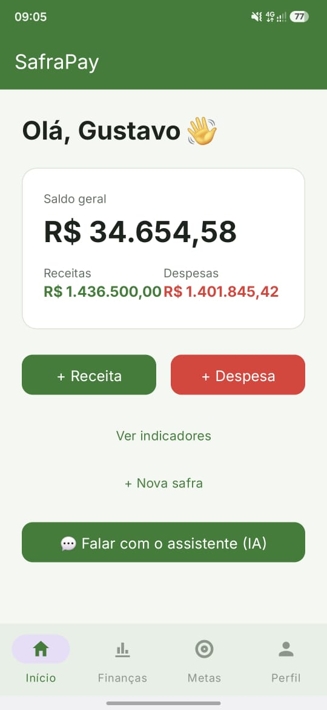
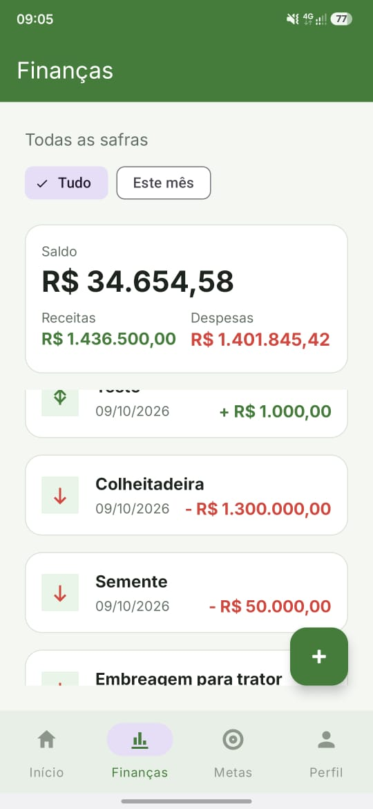
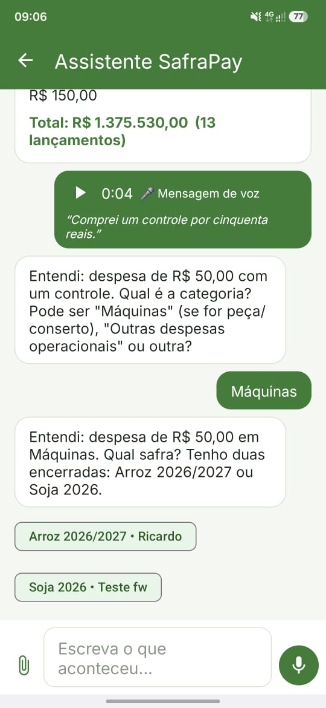
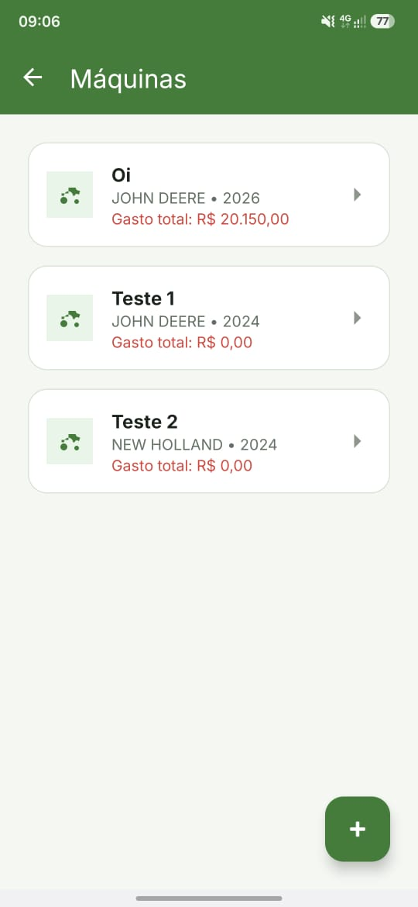
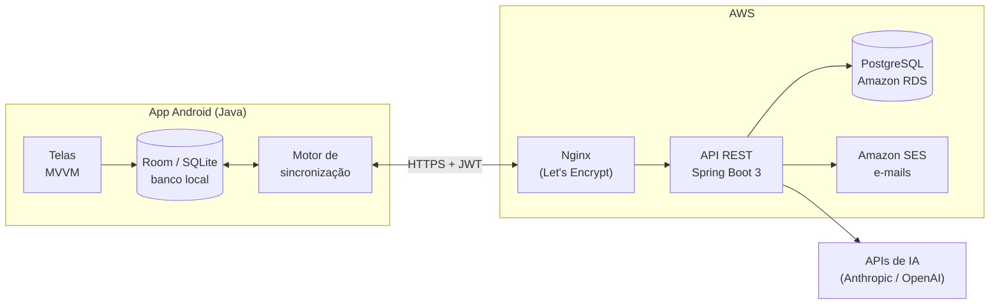

# SafraPay: aplicativo Android

App Android para pequenos e médios produtores rurais controlarem propriedades, talhões, safras, despesas, receitas, metas e máquinas. Funciona **sem internet** no campo e sincroniza com o servidor quando a conexão volta.

Projeto de TCC do curso de Ciência da Computação da UNESC (2026). O aplicativo conversa com o servidor que já está em produção (`https://api.safra-pay.com`), então **não é preciso rodar nenhum servidor** para avaliar. O código do servidor e as instruções dele estão no repositório [safrapay-backend](https://github.com/GustavoPessi/safrapay-backend).

## Telas

| Início | Financeiro | Assistente de IA | Máquinas |
| --- | --- | --- | --- |
|  |  |  |  |

## Funcionalidades

- **Cadastros do produtor:** propriedades, talhões (com geolocalização), safras, máquinas e anotações de manutenção.
- **Financeiro:** despesas por categoria, receitas, metas por safra, indicadores, relatório por período e DRE, com exportação em PDF, Excel e CSV.
- **Offline-first:** tudo é salvo no celular e sincronizado automaticamente ao abrir o app, ao reconectar e após cada alteração.
- **Equipes:** o dono convida gerentes (acesso completo) e colaboradores (só máquinas e tarefas), com prazos e status das tarefas.
- **Assistente de IA:** o produtor manda texto, foto da nota fiscal, planilha ou áudio e o assistente propõe os lançamentos para ele confirmar. Também responde perguntas como "quanto gastei de diesel este mês?".

## 1. Requisitos

- Celular Android **7.0 ou mais novo** (Android 7.0 = API 24). Também roda no emulador do Android Studio.
- Internet para entrar na conta, sincronizar e usar o assistente de IA. O restante funciona sem internet.
- Permissões pedidas durante o uso (todas opcionais): **localização** (marcar o ponto da propriedade/talhão), **microfone** (mensagem de voz no assistente) e **câmera/galeria** (foto do comprovante).

## 2. Instalar o APK (forma recomendada)

1. Baixe o arquivo `SafraPay.apk` pelo link informado na entrega da pré-banca (AVA).
2. Abra o arquivo no celular. Se o Android avisar sobre "fontes desconhecidas", permita a instalação para o app usado para abrir o arquivo (navegador ou gerenciador de arquivos).
3. Toque em **Instalar** e depois em **Abrir**.

> Se o celular já tiver uma versão anterior do SafraPay instalada com outra assinatura, desinstale-a antes.

## 3. Entrar no aplicativo

Cada avaliador cria a **própria conta**, o que já testa o cadastro. Use um e-mail real ao qual você tenha acesso, porque a conta precisa ser confirmada por e-mail.

1. Na primeira abertura aparecem telas de apresentação: toque em **Pular** ou **Próximo** até chegar à tela de login.
2. Toque em **Não tem conta? Cadastre-se**, preencha os dados e conclua o cadastro.
3. Abra o e-mail de confirmação enviado pelo SafraPay (`noreply@safra-pay.com`; confira também a caixa de spam) e toque no link de confirmação.
4. Volte ao app, informe e-mail e senha e toque em **Entrar**. Antes da confirmação, o app avisa "Confirme seu e-mail antes de entrar".

A conta começa vazia: o roteiro abaixo começa pelos cadastros. Os dados ficam no celular e são enviados ao servidor automaticamente; ao entrar com a mesma conta em outro aparelho, eles são baixados (ou use **Perfil → Sincronizar dados**).

Também dá para testar **Esqueci minha senha** na tela de login: o app envia um e-mail com o link para criar uma nova senha.

## 4. Roteiro de teste

A navegação principal fica na barra inferior: **Início**, **Finanças**, **Metas** e **Perfil**. O ícone de voltar fica no canto superior esquerdo.

### 4.1 Cadastros (propriedade → talhão → safra)

1. **Perfil → Cadastros → Minhas propriedades**: abra uma propriedade ou crie uma nova (nome, área, município; o ponto no mapa usa a localização do celular).
2. Dentro da propriedade, abra ou crie um **talhão** (área em hectares e cultura, por exemplo soja).
3. Dentro do talhão, crie uma **safra**. A data de início e o ano já vêm preenchidos com a data de hoje. Se a data de fim cair no ano seguinte, a safra aparece como "2026/2027".
4. Atalho: no **Início**, o botão **+ Nova safra** faz o mesmo caminho de forma guiada.

### 4.2 Finanças

1. No **Início**, toque em **+ Despesa**: escolha a safra, a categoria (Combustível, Insumos, Máquinas etc.), o valor e a data. Opcional: anexar foto do comprovante.
2. Toque em **+ Receita** e registre uma venda.
3. Abra **Finanças** na barra inferior: veja saldo, receitas e despesas. Teste os filtros de **safra** e de **período** (Tudo, Dia, Mês, Ano ou Intervalo; as setas ‹ › passam para o período anterior ou o próximo). Ao rolar a lista, os filtros sobem para dar espaço.
4. Toque em um lançamento para ver o detalhe, editar ou excluir.

### 4.3 Metas

1. **Metas → +**: crie uma meta de resultado para uma safra (valor e prazo).
2. Abra a meta para ver o progresso, calculado como receitas menos despesas da safra.

### 4.4 Indicadores, relatório e DRE

1. No **Início**, toque em **Ver indicadores**: receitas, despesas e saldo por mês, margem e valores por hectare.
2. **Ver relatório por período**: escolha o período e toque em **Exportar** (PDF, Excel ou CSV) para gerar e compartilhar o arquivo.
3. **Ver DRE**: demonstração do resultado do ano.

### 4.5 Máquinas e tarefas

1. **Perfil → Cadastros → Minhas máquinas**: cadastre uma máquina (marca e modelo vêm de um catálogo).
2. No detalhe da máquina, crie uma anotação/tarefa (por exemplo "Trocar óleo") com prazo. Tarefas que vencem em até uma semana aparecem em **Perfil → Notificações**.
3. Uma despesa da categoria **Máquinas** pode ser ligada a uma máquina; o total aparece no detalhe dela.

### 4.6 Assistente de IA (precisa de internet)

No **Início**, toque em **Falar com o assistente (IA)** e teste, por exemplo:

- Texto: "gastei 350 reais de diesel hoje na safra de soja". O assistente propõe o lançamento e só grava depois que você confirma.
- Pergunta: "quanto gastei este mês?" ou "quais safras estão ativas?". Os valores são calculados no próprio celular.
- Pelo clipe: foto de uma nota fiscal ou planilha (.xlsx/.csv). Pelo microfone: mensagem de voz.

### 4.7 Funcionamento sem internet

1. Ative o modo avião.
2. Cadastre uma despesa: ela é salva normalmente no celular.
3. Desative o modo avião: o app sincroniza sozinho em alguns segundos (ou use **Perfil → Sincronizar dados**).

### 4.8 Uso em equipe (opcional, precisa de uma segunda conta, com outro e-mail)

1. Com a conta principal: **Perfil → Minha equipe → Convidar pessoa**, informe o e-mail da segunda conta e o papel (**gerente** usa o app completo com os dados da fazenda; **colaborador** vê só máquinas e tarefas).
2. Com a segunda conta (em outro celular, ou saindo e entrando de novo): **Perfil → Convites recebidos**, abra o convite e aceite.
3. Como colaborador, abra uma tarefa e marque como realizada; o dono vê quem concluiu.

### 4.9 Outros

- **Perfil → Configurações → Exportar meus dados**: planilha com todos os dados da conta.
- **Perfil → Configurações → Sobre e ajuda**: manual de uso do aplicativo.

## 5. Compilar pelo código-fonte (opcional)

1. Instale o **Android Studio** (versão recente, com JDK 17, que já vem junto).
2. Clone o repositório: `git clone https://github.com/GustavoPessi/safrapay-android.git`
3. No Android Studio: **File → Open** e escolha a pasta clonada. Aguarde o Gradle sincronizar (baixa as dependências na primeira vez).
4. Conecte um celular com a depuração USB ativa (ou crie um emulador com API 24 ou mais) e clique em **Run ▶**.
5. Para gerar o APK: **Build → Build App Bundle(s) / APK(s) → Build APK(s)**. O arquivo fica em `app/build/outputs/apk/debug/app-debug.apk`.

Não é preciso configurar chave nem variável de ambiente: o endereço do servidor (`https://api.safra-pay.com/`) está em `app/src/main/java/com/tcc/gestaorural/data/remote/RetrofitClient.java`. As chaves das APIs de IA ficam só no servidor.

## 6. Arquitetura e tecnologias



| Camada | Tecnologias |
| --- | --- |
| Linguagem e UI | Java 17, Views em XML, Material 3 |
| Arquitetura | MVVM (Activity → ViewModel → Repository → DAO), LiveData |
| Dados locais | Room sobre SQLite |
| Rede | Retrofit e OkHttp, com renovação automática do token (JWT) |
| Build | `minSdk 24`, `targetSdk 34`, Android Gradle Plugin 8.13 |
| Back-end | Spring Boot 3 e PostgreSQL na AWS ([safrapay-backend](https://github.com/GustavoPessi/safrapay-backend)) |
| Design | Figma (mais de 30 telas e design system próprio) |

### Organização do código

```
app/src/main/java/com/tcc/gestaorural/
  data/     → Room (entidades, DAOs), API (Retrofit), repositórios e motor de sincronização
  ui/       → telas, por funcionalidade
  export/   → exportação de relatório e de dados (PDF, Excel, CSV)
  util/     → sessão, datas, máscaras e utilitários
```

### Decisões técnicas

**Sincronização offline.** Cada registro nasce no celular com um UUID, que é a identidade usada nos dois bancos (os ids autoincremento nunca coincidem). O app envia o que mudou (`sincronizado = 0`) e baixa o que mudou no servidor desde a última sincronização. Conflitos são resolvidos por *last-write-wins* pelo `atualizado_em`. Exclusões também viajam, para um item apagado não "ressuscitar" na próxima sincronização. Pais sincronizam antes dos filhos (propriedade → talhão → safra → lançamentos).

**Gatilhos automáticos com trava.** A sincronização roda ao abrir o app, quando a internet volta e alguns segundos depois de cada alteração local. Uma trava impede duas sincronizações ao mesmo tempo.

**Sessão que não cai.** O app guarda o token de acesso e o refresh token. Um interceptor do Retrofit renova o token sozinho quando a API responde 401 ou 403, fazendo um único refresh mesmo com várias chamadas simultâneas.

**IA que entende, app que calcula.** O assistente nunca calcula valores: ele devolve a intenção (um lançamento proposto ou uma consulta com filtros) e o app executa no Room. Assim os números são sempre exatos, incluem o que ainda não sincronizou, e nenhum valor financeiro é enviado para a IA.

## 7. Problemas comuns

- **"Sem conexão" ao entrar:** confira a internet do celular; o servidor `https://api.safra-pay.com` precisa estar acessível.
- **Dados não aparecem depois do login:** **Perfil → Sincronizar dados**.
- **Não chegou o e-mail de confirmação:** verifique a caixa de spam e aguarde alguns minutos; confira se o e-mail foi digitado corretamente no cadastro.
- **Assistente não responde:** ele precisa de internet; sem conexão, o restante do app continua funcionando.

## Autor

**Gustavo Borges Pessi** · Ciência da Computação, UNESC, 2026 · [LinkedIn](https://www.linkedin.com/in/gustavopessi/) · [GitHub](https://github.com/GustavoPessi)
