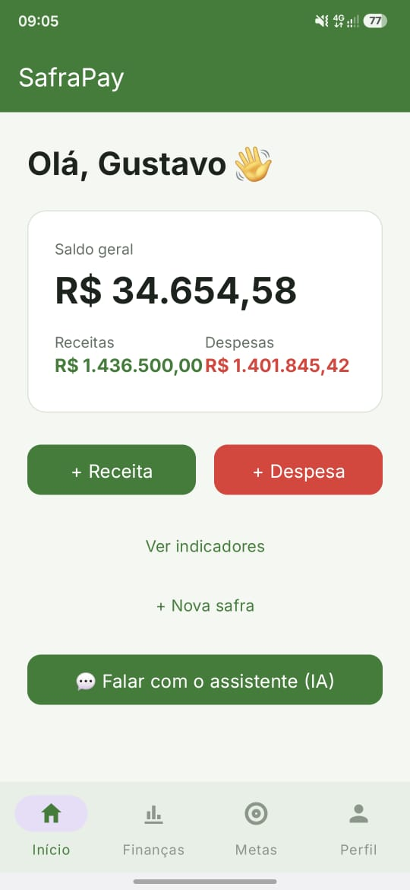
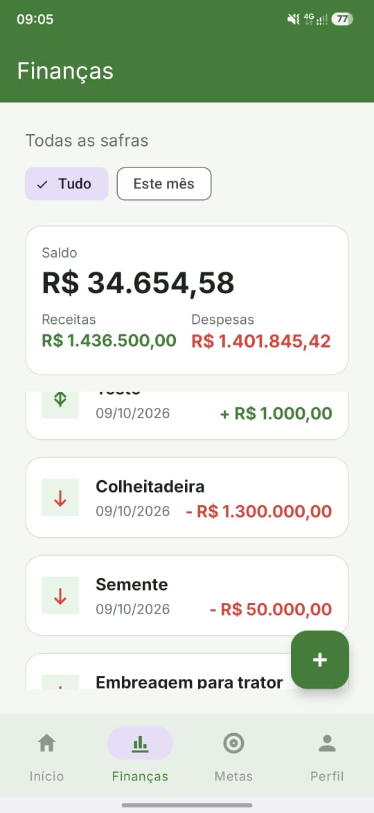
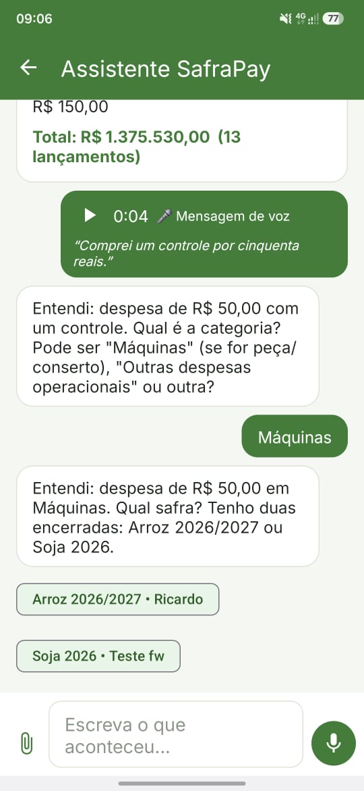
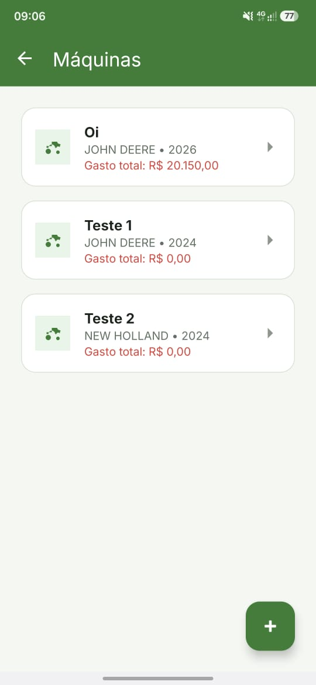
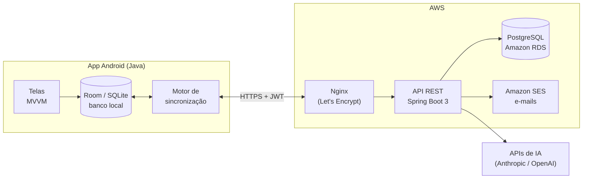

# SafraPay — App Android

App Android para pequenos e médios produtores rurais controlarem propriedades, talhões, safras, despesas, receitas, metas e máquinas. Funciona **sem internet** no campo e sincroniza com o servidor quando a conexão volta.

Projeto de TCC do curso de Ciência da Computação da UNESC (2026), desenvolvido com foco em virar produto. O backend está em [safrapay-backend](https://github.com/GustavoPessi/safrapay-backend).

## Telas

| Início | Financeiro | Assistente de IA | Máquinas |
| --- | --- | --- | --- |
|  |  |  |  |

## Funcionalidades

- **Cadastros do produtor:** propriedades, talhões (com geolocalização), safras, máquinas e anotações de manutenção.
- **Financeiro:** despesas por categoria, receitas, metas por safra e indicadores.
- **Offline-first:** tudo é salvo no celular e sincronizado automaticamente ao abrir o app, ao reconectar e após cada alteração.
- **Equipes:** o dono convida gerentes (acesso completo) e colaboradores (só máquinas e tarefas), com prazos e status das tarefas.
- **Assistente de IA:** o produtor manda texto, foto da nota fiscal, planilha ou áudio e o assistente propõe os lançamentos para ele confirmar. Também responde perguntas como "quanto gastei de diesel este mês?".

## Arquitetura



## Stack

| Camada | Tecnologias |
| --- | --- |
| Linguagem e UI | Java, Views em XML, Material 3 |
| Arquitetura | MVVM (Activity → ViewModel → Repository → DAO), LiveData |
| Dados locais | Room sobre SQLite |
| Rede | Retrofit e OkHttp, com renovação automática do token |
| Back-end | Spring Boot 3 e PostgreSQL na AWS ([safrapay-backend](https://github.com/GustavoPessi/safrapay-backend)) |
| Design | Figma (mais de 30 telas e design system próprio) |

## Decisões técnicas

**Sincronização offline.** Cada registro nasce no celular com um UUID, que é a identidade usada nos dois bancos (os ids autoincremento nunca coincidem). O app envia o que mudou (`sincronizado = 0`) e baixa o que mudou no servidor desde a última sincronização. Conflitos são resolvidos por *last-write-wins* pelo `atualizado_em`. Exclusões também viajam, para um item apagado não "ressuscitar" na próxima sincronização. Pais sincronizam antes dos filhos (propriedade → talhão → safra → lançamentos).

**Gatilhos automáticos com trava.** A sincronização roda ao abrir o app, quando a internet volta e alguns segundos depois de cada alteração local. Uma trava impede duas sincronizações ao mesmo tempo.

**Sessão que não cai.** O app guarda o token de acesso e o refresh token. Um interceptor do Retrofit renova o token sozinho quando a API responde 401 ou 403, fazendo um único refresh mesmo com várias chamadas simultâneas.

**IA que entende, app que calcula.** O assistente nunca calcula valores: ele devolve a intenção (um lançamento proposto ou uma consulta com filtros) e o app executa no Room. Assim os números são sempre exatos, incluem o que ainda não sincronizou, e nenhum valor financeiro é enviado para a IA.

## Como rodar

1. Abra a pasta do projeto no **Android Studio**.
2. Aguarde o Gradle sincronizar.
3. Rode em um emulador ou celular com Android 7.0 ou mais novo (minSdk 24).

## Estrutura

```
app/src/main/java/com/tcc/gestaorural/
  data/     → Room (entidades, DAOs), API (Retrofit) e motor de sincronização
  ui/       → telas, por funcionalidade
  export/   → exportação de dados
  util/     → sessão, datas e utilitários
```

## Autor

**Gustavo Borges Pessi** · [LinkedIn](https://www.linkedin.com/in/gustavo-pessi-b8a09b368/) · [GitHub](https://github.com/GustavoPessi)
